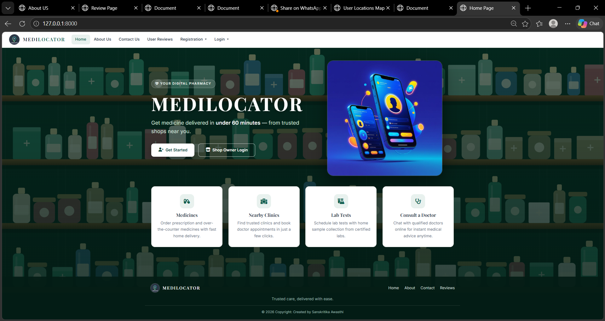
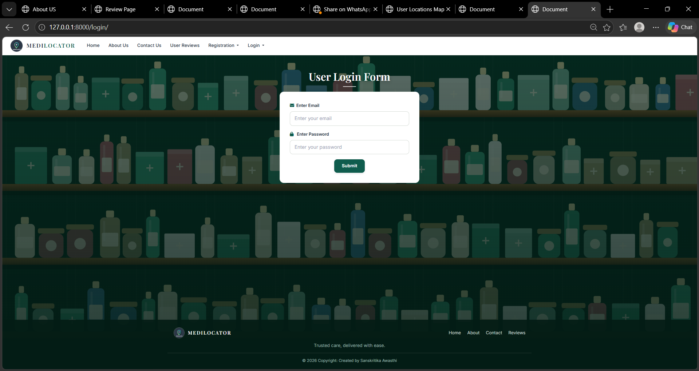
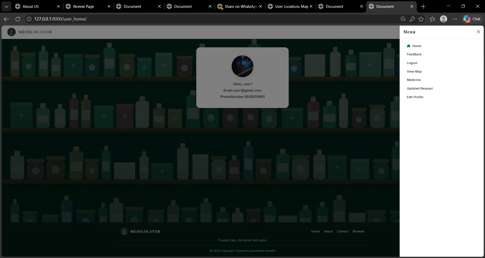
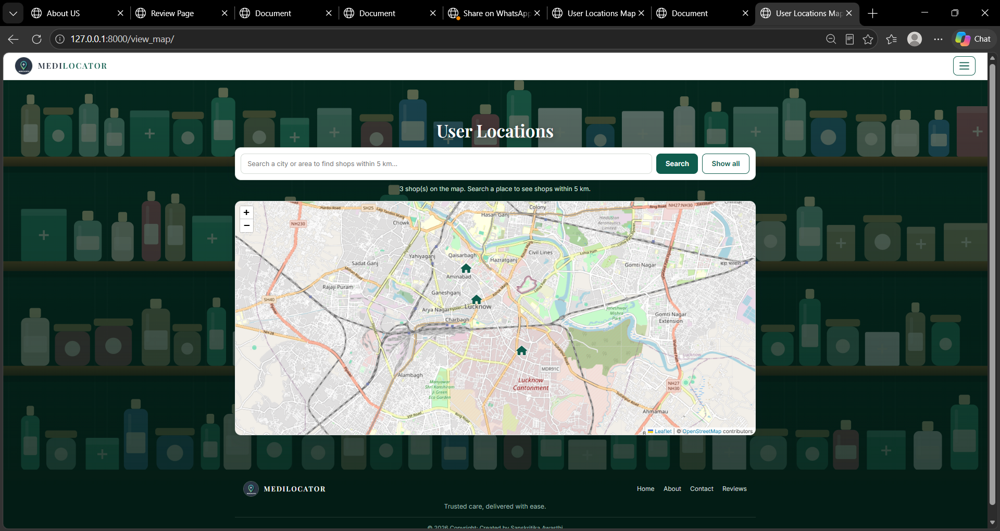
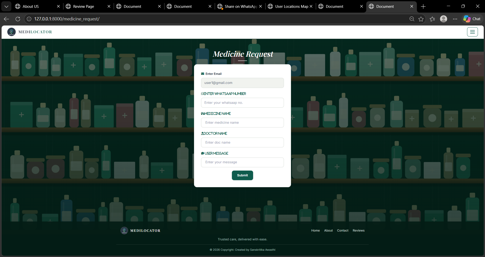
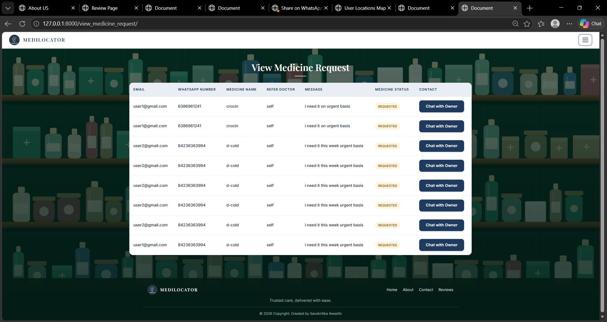
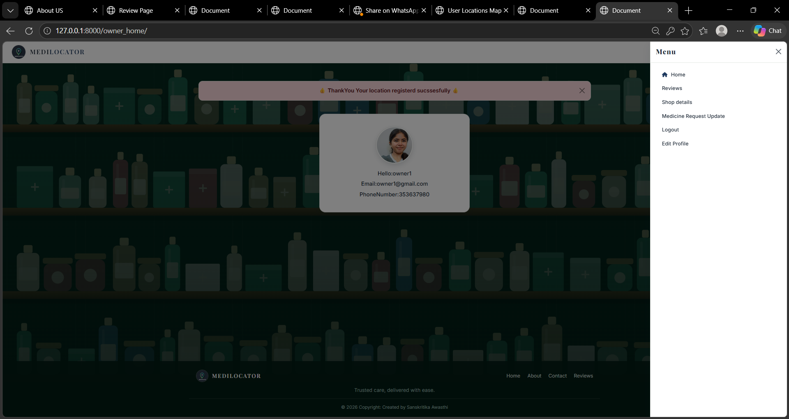
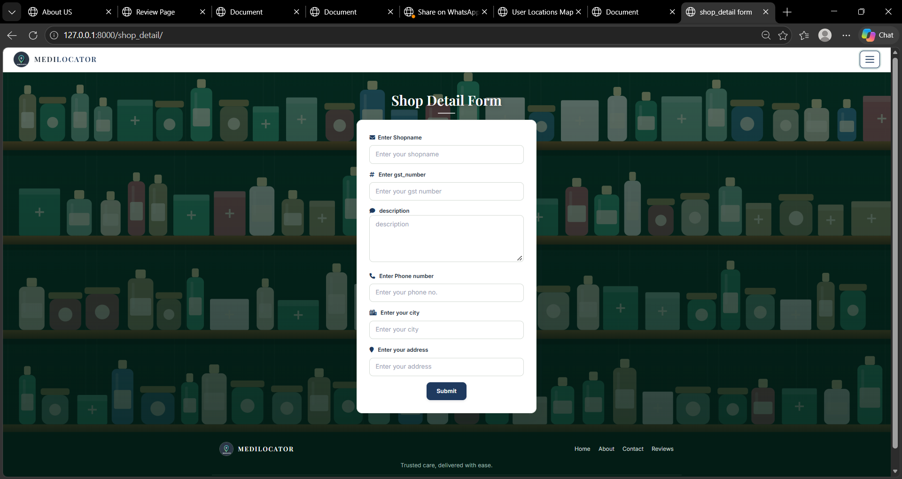
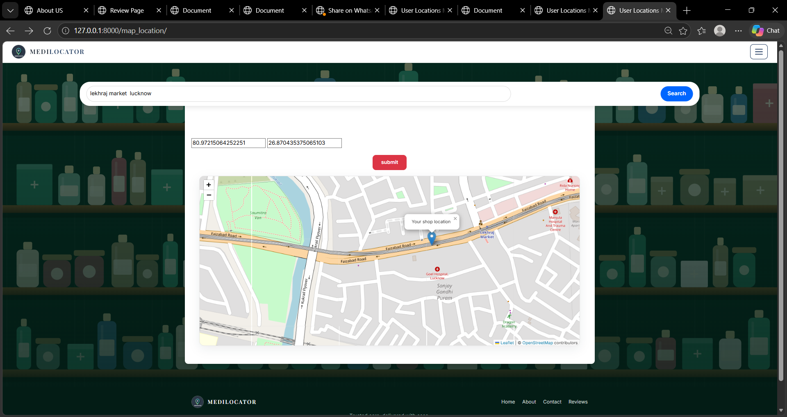
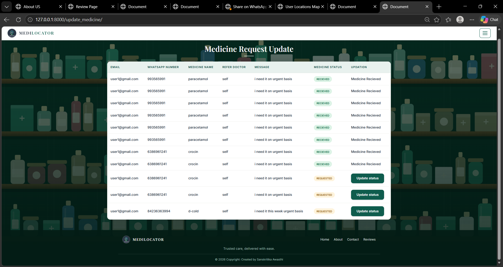

<div align="center">


# MediLocator

**Find nearby medical shops, locate them on a map, and request medicines — all in one place.**


</div>

---

## Table of Contents

- [About](#about)
- [Features](#features)
- [Screenshots](#screenshots)
- [Tech Stack](#tech-stack)
- [Project Structure](#project-structure)
- [Getting Started](#getting-started)
- [Usage Guide](#usage-guide)
- [Routes](#routes)
- [Data Model](#data-model)
- [Roadmap](#roadmap)
- [Contributing](#contributing)
- [License](#license)

## About

**MediLocator** is a Django web application that connects people who need medicines with local pharmacies and medical shops. Shop owners register their store, pin its exact location on a map, and receive medicine requests. Users browse shops on an interactive map, send a request for a medicine they cannot find, and track its status.

## Features

### For Users
- Register, log in, and manage a personal profile with a photo
- View every registered medical shop on an interactive map
- Submit a medicine request with the medicine name, referring doctor, WhatsApp number and a message
- Track and update request status (`Requested`, `Medicine Received`, `Request Cancelled`)
- Leave feedback and ratings, and read what others have said

### For Shop Owners
- Separate registration, login and profile management
- Add shop details: name, GST number, city, address, phone and description
- Pick the shop's exact location on a map (Leaflet with OpenStreetMap search)
- View incoming medicine requests from users

### General
- Public home, About Us and Contact Us pages
- Public feedback wall
- Custom theme with SVG patterns and a refined shop-inspired design

## Screenshots

> Add your screenshots to [`docs/screenshots/`](docs/screenshots) using the file names below and they will appear here automatically.

| Home | User Login |
|:---:|:---:|
|  |  |

| User Dashboard | Shop Map |
|:---:|:---:|
|  |  |

| Medicine Request | Request Tracking |
|:---:|:---:|
|  |  |

| Owner Dashboard | Shop Details |
|:---:|:---:|
|  |  |

| Pin Shop Location | Incoming Requests |
|:---:|:---:|
|  |  |

## Tech Stack

| Layer | Technology |
|---|---|
| Backend | Python, Django 5.2 |
| Database | SQLite (default, easy to swap) |
| Frontend | HTML5, CSS3, JavaScript, Bootstrap 5.3 |
| Maps | Leaflet 1.9 + OpenStreetMap (Nominatim search) |
| Fonts | Inter, Playfair Display, Cormorant Garamond, Poppins |

## Project Structure

```
Medilocator/
├── manage.py
├── requirements.txt
├── Medilocator/              # Project settings and root URLs
│   ├── settings.py
│   └── urls.py
├── medi_app/                 # Main application
│   ├── models.py             # FeedBack, Contact, User, ShopOwner, ShopDetail, MedicineRequest
│   ├── views.py              # Public pages
│   ├── user_views.py         # User-side logic
│   ├── owner_views.py        # Shop-owner logic
│   ├── urls.py
│   ├── migrations/
│   ├── static/medi_app/      # css, images, SVG patterns
│   └── templates/medi_app/
│       ├── common/           # shared header, footer, css
│       ├── html/             # public pages
│       ├── user/             # user pages
│       └── shopowner/        # owner pages
├── media/                    # Uploaded profile pictures
└── docs/screenshots/         # README images
```

## Getting Started

### Prerequisites
- Python 3.10 or newer
- pip
- Git

### Installation

```bash
# 1. Clone the repository
git clone https://github.com/<your-username>/Medilocator.git
cd Medilocator

# 2. Create and activate a virtual environment
python -m venv venv
# Windows
venv\Scripts\activate
# macOS / Linux
source venv/bin/activate

# 3. Install dependencies
pip install -r requirements.txt

# 4. Apply database migrations
python manage.py migrate

# 5. (Optional) Create an admin account
python manage.py createsuperuser

# 6. Start the development server
python manage.py runserver
```

Open **http://127.0.0.1:8000/** in your browser.

> The map pages load Leaflet, Bootstrap and fonts from CDNs, so an internet connection is required.

## Usage Guide

**As a user**
1. Register at `/reg/` and log in at `/login/`.
2. Open the map at `/view_map/` to see registered shops.
3. Submit a request at `/medicine_request/`, then follow it at `/update_medicine/`.

**As a shop owner**
1. Register at `/owner_registration/` and log in at `/owner_login/`.
2. Fill in your shop at `/shop_detail/`.
3. Pin your location at `/map_location/`.
4. Review requests at `/view_medicine_request/`.

## Routes

| Path | Purpose |
|---|---|
| `/` | Home |
| `/about/`, `/contact/` | Public information pages |
| `/all_feedback/` | Public feedback wall |
| `/reg/`, `/login/`, `/user_home/`, `/user_edit_profile/`, `/user_logout/` | User account |
| `/user_feedback/` | Submit feedback |
| `/view_map/`, `/view_shopkeeper/` | Browse shops |
| `/medicine_request/`, `/update_medicine/`, `/update_status/<id>` | Medicine requests |
| `/owner_registration/`, `/owner_login/`, `/owner_home/`, `/owner_edit_profile/`, `/owner_logout/` | Owner account |
| `/shop_detail/`, `/map_location/`, `/view_medicine_request/` | Owner tools |
| `/admin/` | Django admin |

## Data Model

| Model | Key fields |
|---|---|
| `User` | name, email (PK), password, phone, pic_name |
| `ShopOwner` | name, email (PK), password, phone, pic_name |
| `ShopDetail` | owner (FK), shop_name, gst_number (PK), city, address, phone_no, location_lat, location_long, description |
| `MedicineRequest` | user_email, user_whatsapp, medicine_name, refer_doctor_name, user_message, medicine_status |
| `FeedBack` | email (PK), name, rating, query, user_pic, date |
| `Contact` | email, name, phone, question, date |

## Roadmap

Planned improvements before any production deployment:

- [ ] Hash passwords (e.g. Django's `make_password` / `check_password`) instead of storing plain text
- [ ] Move `SECRET_KEY` and `DEBUG` to environment variables
- [ ] Use Django's built-in authentication or add login-required checks on protected views
- [ ] Link `MedicineRequest` to shops so owners only see relevant requests
- [ ] Search shops by city and distance from the user
- [ ] Email or WhatsApp notifications when a request is fulfilled
- [ ] Automated tests and CI

## Contributing

Contributions are welcome.

1. Fork the repository
2. Create a branch: `git checkout -b feature/your-feature`
3. Commit your changes: `git commit -m "Add your feature"`
4. Push the branch: `git push origin feature/your-feature`
5. Open a Pull Request

## License

Distributed under the MIT License. Add a `LICENSE` file to the repository root before publishing.

---

<div align="center">
Built with Django.
</div>
"# medilocator-pharmacy-finder" 
